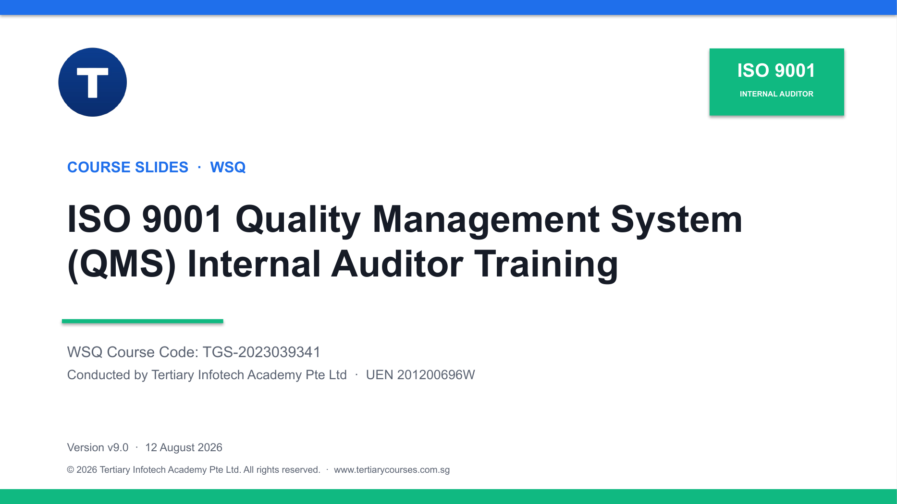

# ISO 9001 Quality Management System (QMS) Internal Auditor Training

Complete WSQ courseware for risk-based ISO 9001 internal audit planning, evidence evaluation, audit findings, corrective action, reporting, procedure updates and follow-up.

| Course detail | Information |
|---|---|
| Course code | `TGS-2023039341` |
| Programme | WSQ |
| Duration | 2 days · 16 hours, plus a 1-hour Written Assessment and a 1-hour Case Study |
| Registration | [View course details and register](https://www.tertiarycourses.com.sg/wsq-iso-9001-quality-management-system-qms-internal-auditor-training.html) |
| Funding | Up to 70% course-fee funding for eligible learners. Eligibility and terms apply; the course page states funding validity through 26 October 2027. |
| Courseware release | v9.0 |

## About the course

Learners plan and run a risk-based internal audit programme against ISO 9001:2015 (with Amendment 1:2024) using ISO 19011 auditing guidance, then evaluate evidence, write findings, drive corrective action and verify follow-up through eight applied activities.

## Learning outcomes

- **LO1:** Conduct ISO 9001 internal audit activities using methodologies that ensure organisational compliance.
- **LO2:** Analyse audit findings to identify process inefficiencies, non-compliance issues and areas for improvement.
- **LO3:** Propose actionable improvement plans to mitigate identified risks and non-compliance issues.
- **LO4:** Implement updated audit procedures following changes in internal compliance standards or external regulatory guidelines.

## Courseware

- [Trainer deck (PPTX)](courseware/ISO%209001%20QMS%20Internal%20Auditor%20Training-v9.0.pptx)
- [Trainer/learner slides (PDF)](courseware/ISO%209001%20QMS%20Internal%20Auditor%20Training-v9.0.pdf)
- [Learner Guide (DOCX)](courseware/LG-ISO%209001%20QMS%20Internal%20Auditor%20Training.docx)
- [Learner Guide (PDF)](courseware/LG-ISO%209001%20QMS%20Internal%20Auditor%20Training.pdf)
- [Learner Guide source (Markdown)](LG-ISO%209001%20QMS%20Internal%20Auditor%20Training.md)
- [Lesson Plan (DOCX)](courseware/LP-ISO%209001%20QMS%20Internal%20Auditor%20Training.docx)
- [Lesson Plan (PDF)](courseware/LP-ISO%209001%20QMS%20Internal%20Auditor%20Training.pdf)
- [QA report](QA-REPORT.md)

The slide deck is concept-led and highly visual. Detailed facilitation procedures, scenarios and working instructions are kept in the Learner Guide and activity folders.

## Activities

Every activity is self-contained in its own numbered folder with:

- a detailed `README.md` containing the scenario, questions, procedure, evidence and acceptance criteria;
- a printable two-page PDF activity pack; and
- an Excel workbook or checklist for the learner's working evidence.

| Activity | Applied output |
|---|---|
| [01 — Build a Risk-Based Internal Audit Programme](activities/01-build-a-risk-based-internal-audit-programme/) | Twelve-month programme, objectives, risks and KPIs |
| [02 — Translate a Process into an Audit Trail](activities/02-translate-a-process-into-an-audit-trail/) | SIPOC, control/evidence matrix and vertical/horizontal trails |
| [03 — Design a Clause-to-Process Audit Checklist](activities/03-design-a-clause-to-process-audit-checklist/) | Process-based checklist and sampling plan |
| [04 — Conduct an Interview and Triangulate Evidence](activities/04-conduct-an-interview-and-triangulate-evidence/) | Interview plan, evidence log and corroborated conclusion |
| [05 — Evaluate Evidence and Write Audit Findings](activities/05-evaluate-evidence-and-write-audit-findings/) | Evidence evaluation and Requirement-Evidence-Gap findings |
| [06 — Build a Root-Cause and Corrective-Action Plan](activities/06-build-a-root-cause-and-corrective-action-plan/) | Containment, cause analysis, actions and effectiveness measures |
| [07 — Present an Audit Report and Improvement Priorities](activities/07-present-an-audit-report-and-improvement-priorities/) | Audit report, priority matrix and closing-meeting brief |
| [08 — Update Audit Procedures and Verify Follow-Up](activities/08-update-audit-procedures-and-verify-follow-up/) | Change impact, controlled procedure update and follow-up decision |

## Topics covered

1. Introduction to Audit Activities and Compliance Methodologies
2. Analysis and Interpretation of Audit Results
3. Risk Mitigation and Improvement Measures
4. Adherence to Compliance Standards

The two-day programme provides 16 training hours followed by a one-hour Written Assessment and one-hour Case Study assessment. The formal instruments are managed separately and are intentionally excluded from this public repository.

## Standards baseline

The release uses **ISO 9001:2015 with Amendment 1:2024** as the current QMS requirements baseline and **ISO 19011:2026** as current auditing guidance. The forthcoming ISO 9001 revision is treated as change-monitoring context, not as an auditable requirement.

Content was strengthened using the official course listing and curriculum references from [TUV SUD Academy](https://www.tuvsud.com/en-sg/store/academy-sg/sectors/management-systems/0001-iso-9001-2015-internal-auditor), [Singapore Quality Institute](https://www.sqi.org.sg/courses/apply-iso-9001-quality-management-system/), [ISO 9001](https://www.iso.org/standard/62085.html) and [ISO 19011](https://www.iso.org/standard/82411.html).

## Public and private distribution boundary

This repository publishes the slide deck, Learner Guide, Lesson Plan and activities. Question papers, answer keys, the Facilitator Guide and Assessment Plan, learner submissions, assessment records, source references and publication credentials are never committed; they are distributed privately through Tertiary Infotech systems and excluded through `.gitignore`.

## Provider

Tertiary Infotech Academy Pte Ltd  
UEN: 201200696W  
[tertiarycourses.com.sg](https://www.tertiarycourses.com.sg/)
